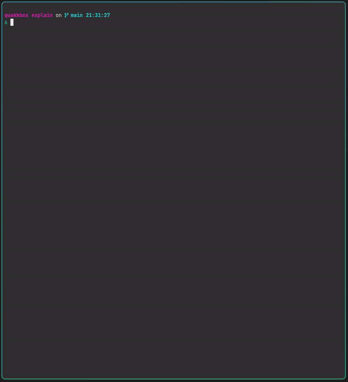
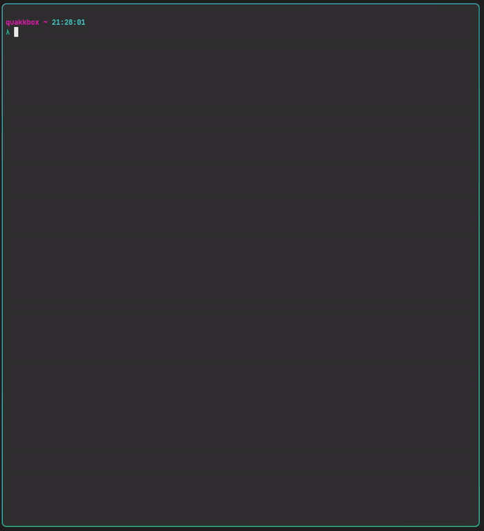

# Explain CLI

A command-line tool that uses OpenAI's GPT models to explain anything you throw at it. Whether you have a quick question or need detailed analysis of complex content, `explain` provides intelligent responses right in your terminal. AI wrote this readme.

## Demo

### Basic input with arguments


### Explain piped input


## Features

- **Multiple Input Methods**: Support for direct questions and piped content
- **Current Answers**: GPT-5.6 Terra can search the web when a question needs up-to-date or uncertain facts
- **Visible Sources**: Web-derived answers include numbered citations and source URLs in the terminal
- **Configurable Model and Reasoning**: Set clear defaults and override either per request
- **Verbose Mode**: Detailed configuration and processing information
- **Input Validation**: Automatic token counting and size limits
- **Automatic Context**: Uses a short recent conversation window without requiring a flag
- **Durable Memory**: Terra can maintain global and project-specific facts and preferences through local tools
- **Private Piped History**: Records only piped-input metadata, never the raw piped contents

## Installation

### Prerequisites

- [.NET 10.0 SDK](https://dotnet.microsoft.com/download/dotnet/10.0) (for building from source)
- OpenAI API key

### Quick Setup

1. **Clone the repository**:
   ```bash
   git clone https://github.com/grankko/explain.git
   cd explain
   ```

2. **Configure your API key**:
   ```bash
   # Depending on how you do this you might be exposing that api key more than you should
   #
   # Option 1: Create user configuration (recommended)
   mkdir -p ~/.config/explain
   cp src/Explain.Cli/appsettings.example.json ~/.config/explain/appsettings.json
   # Edit ~/.config/explain/appsettings.json with your OpenAI API key
   
   # Option 2: Use application directory configuration
   cp src/Explain.Cli/appsettings.example.json src/Explain.Cli/appsettings.json
   # Edit src/Explain.Cli/appsettings.json with your OpenAI API key
   
   # Option 3: Use environment variables (works with any setup)
   export EXPLAIN_OPENAI_KEY="your-api-key-here"
   ```

3. **Build and publish**:
   ```bash
   chmod +x publish.sh
   ./publish.sh --bump-patch
   ```

4. **Install globally** (optional):
   ```bash
   # The publish script creates a self-contained executable at publish/explain
   # You can copy it to your PATH or use the provided wrapper script
   ```

## Configuration and Data Storage

The `explain` CLI uses a user configuration directory for storing settings and data:

- **Configuration Directory**: `~/.config/explain/`
- **Database Location**: `~/.local/share/explain/explain_history.sqlite`
- **User Config File**: `~/.config/explain/appsettings.json` (optional)

### Configuration Priority

The application loads configuration in the following order (higher priority overrides lower):

1. **Command line arguments** (highest priority)
2. **Environment variables**: 
   - `EXPLAIN_OPENAI_KEY`
   - `EXPLAIN_OPENAI_DEFAULT_MODEL_NAME`
   - `EXPLAIN_OPENAI_DEFAULT_REASONING_EFFORT`
3. **User configuration file**: `~/.config/explain/appsettings.json`
4. **Application configuration file**: `src/Explain.Cli/appsettings.json` (lowest priority)

The configuration directory and database are automatically created when the application first runs. The database contains local plaintext conversation history and durable memory; protect it like other user data.

On the first non-ephemeral invocation, Explain records a privacy-balanced local system profile containing the OS, kernel, architecture, shell name, and timezone. It never collects hostname, username, network details, environment values, or hardware identifiers. `--refresh-system` re-collects and replaces only those reserved local facts; it does not make an AI request. It may be combined with a question, so the refreshed profile is available to that request.

`OpenAi:DefaultModelName` defaults to `gpt-5.6-terra` and `OpenAi:DefaultReasoningEffort` defaults to `medium`. Override either for a single request with `--model` and `--reasoning`; use `--reasoning none` for models that do not support reasoning. If the API key cannot access a chosen model, Explain reports that directly without exposing raw API details.

Web search is available automatically—there is no search flag. The model decides whether a lookup is useful, and successful searches add plain numbered markers to the answer plus a terminal-friendly `Sources:` section. Raw Markdown links are converted to readable text, while full source URLs remain visible and terminal-clickable. Web searches are billed as tool calls in addition to model token usage. A memory update requires a local function-tool round trip and may add model tokens, but no separate external service charge.

## Usage

### Direct Questions
```bash
explain "What is machine learning?"
explain "How do I list hidden files in Linux?"
explain "Explain quantum computing in simple terms"
```

### Automatic History Context

Explain automatically includes up to four exchanges from the current six-hour session. Use `--include-history` only to override that selection:
```bash
# Explicitly include the last 3 entries from any age
explain "What about supervised learning?" --include-history

# Include last 5 history entries  
explain "Can you elaborate on that?" --include-history 5

# Include as many entries as fit the safe context budget
explain "Summarize our entire conversation" --include-history 0

# Fully ephemeral: load and save neither history nor memory
explain "One-off private question" --no-history
```
### Model and Reasoning Overrides
For a different model or reasoning effort on one request:
```bash
explain "Analyze the trade-offs between microservices and monolithic architecture" --reasoning high
explain "Review this code" --model gpt-5.6-terra --reasoning medium
explain "Summarize this" --model gpt-4.1 --reasoning none
```

`--reasoning` accepts `none`, `minimal`, `low`, `medium`, `high`, or `xhigh`. Model support differs by model; choose `none` for a non-reasoning model.

### Piped Input
Analyze files, command output, or any text content:
```bash
# Explain file contents
cat README.md | explain

# Analyze command output
ls -la | explain "What do these file permissions mean?"

# Process log files
tail -n 100 /var/log/syslog | explain "Summarize any issues"

# Explain code
cat main.py | explain "What does this Python code do?"

# Handle error messages (stderr)
dmesg 2>&1 | explain "Why did this fail?"
```

### History Management
View your previous questions and explanations:
```bash
# Show last 5 questions (default)
explain --show-history

# Show last 10 questions
explain --show-history 10

# Show all history
explain --show-history 0
```

Clear all history entries:
```bash
# Clear all history (requires typing 'yes' to confirm)
explain --clear-history
```

**Note**: The `--show-history` and `--clear-history` flags cannot be combined with other input methods (questions, piped content, or other flags).

Raw piped contents are sent to OpenAI for the current request but are not retained in history. Local memory tools are disabled for piped requests, so piped text cannot become a memory-tool argument. History records only the typed question, piped character count, answer, timestamp, model, and token usage.

### Memory Management

Terra can automatically create concise, non-sensitive memories when a stable fact or preference will improve future answers. Global memories follow you everywhere; project memories are scoped to the nearest Git root or current directory. Memory changes are always announced by key.

```bash
explain "Remember that I prefer examples in C#"
explain "Forget my language preference"
explain "Refresh what you know about this system"
explain --show-memory
explain --clear-memory
explain --refresh-system
```

`--clear-memory` removes AI-created memories after confirmation while retaining the reserved system profile. The model cannot directly edit `system.*` facts; it can only invoke the deterministic refresh routine.

### Command Line Options

- `--verbose`: Display detailed configuration and processing information
- `--model <name>`: Use an OpenAI model for this request instead of `OpenAi:DefaultModelName`
- `--reasoning <effort>`: Use `none`, `minimal`, `low`, `medium`, `high`, or `xhigh` for this request instead of `OpenAi:DefaultReasoningEffort`
- `--include-history [number]`: Override automatic recent history
  - Without number: Includes the last 3 entries from any age
  - With number: Includes specified number of entries
  - With 0: Includes as many entries as fit the context budget
- `--no-history`: Run ephemerally without loading or saving history or memory
- `--show-history [number]`: Display previous questions and explanations
  - Without number: Shows last 5 entries (default)
  - With number: Shows specified number of entries
  - With 0: Shows all history entries
  - Cannot be combined with other input or flags
- `--clear-history`: Clear all history entries
  - Requires typing 'yes' to confirm deletion
  - Cannot be combined with other input or flags
- `--show-memory`: Display reserved system facts and AI-created global/project memories
- `--clear-memory`: Clear AI-created memories after confirmation while retaining system facts
- `--refresh-system`: Re-collect the reserved local system profile (OS, kernel, architecture, shell, and timezone); it does not make an AI request and may be combined with a question

### Building and Testing

```bash
# Build the project
dotnet build src/Explain.Cli/Explain.Cli.csproj

# Run unit tests only (default - integration tests are ignored)
dotnet test src/Explain.Cli.Tests/

# Run integration tests specifically (requires temporarily uncommenting [Ignore] attributes)
# Comment out the [Ignore] attributes in IntegrationTests/ExplainCommandIntegrationTests.cs first
dotnet test src/Explain.Cli.Tests/ --filter "FullyQualifiedName~IntegrationTests"

# Debug mode
dotnet run --project src/Explain.Cli -- "your question here"
```

**Note**: Integration tests are ignored by default to prevent environment lockup during regular test runs. They test the CLI as a separate process and require the application to be built first.

### VS Code Integration

The project includes VS Code configuration for easy development:

- **F5**: Start debugging with sample arguments
- **Build task**: Available in the command palette
- **Launch configurations**: Pre-configured for different scenarios

### Publishing

The root `VERSION` file is Explain's authoritative semantic version. Show the version compiled into an executable with:

```bash
explain --version
```

Publishing requires exactly one version bump flag. Patch increments only the patch number; minor and major bumps reset the lower components to zero:

```bash
./publish.sh --bump-patch # 0.2.0 -> 0.2.1
./publish.sh --bump-minor # 0.2.0 -> 0.3.0
./publish.sh --bump-major # 0.2.0 -> 1.0.0
```

The script publishes the bumped version as a self-contained Linux executable at `publish/explain`, then updates `VERSION` only after publishing succeeds.
